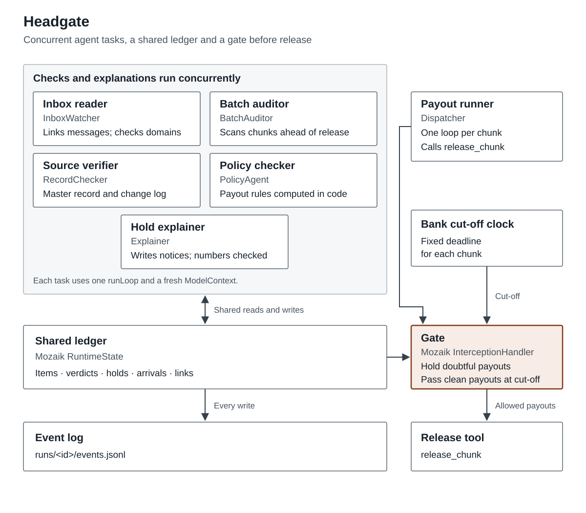

# Headgate

**Doubtful payouts wait. The batch keeps moving.**

Replay: [headgate-replay.vercel.app](https://headgate-replay.vercel.app) · Demo video (98 s): [youtu.be/OAmQfgiVWW8](https://youtu.be/OAmQfgiVWW8)

> Synthetic data only. Not financial advice. Nothing in this project moves money.

## What it does

A creator marketplace pays its creators in one Black Friday payout batch. While the batch runs, requests to change a creator's payout account keep arriving by email and support ticket, and some of them are account takeovers ("send today's payment to ACCT-6885 instead", from a look-alike domain). Checking the inbox once before the batch, or checking messages one at a time, can end up paying the attacker or paying honest creators late.

Headgate runs six agents at the same time on Mozaik while the batch is released chunk by chunk on a fixed bank cut-off clock. A gate in front of the release tool lets clean payouts leave on their cut-off and holds only the payouts whose account is in doubt, with the record rows that prove why (for example `data/master.csv#CR-0024` and `data/arrivals.csv#IN-0002`). An operator can then approve a hold, which pays the **verified account on file**, or reject it, which keeps the payout held. In this demo nothing moves.

Why this matters (public context, not a result of this project): the FBI's [2024 IC3 Annual Report](https://www.ic3.gov/AnnualReport/Reports/2024_IC3Report.pdf) lists 21,442 Business Email Compromise complaints and $2,770,151,146 in reported losses for 2024, and FBI IC3 alert [I-112525-PSA](https://www.ic3.gov/PSA/2025/PSA251125) reports more than 5,100 account-takeover complaints with losses above $262 million since January 2025.

## Why concurrency matters here

The bank cut-off does not wait. Messages arrive, the inbox has to be read, the next chunks audited and the records checked, all before each chunk's cut-off. Running those checks at the same time lets them share the deadline window; unfinished work can still cause a hold, and with the default fail policy the gate does not release a payout it is unsure about.

The comparison is fair by construction: the one-loop-at-a-time baseline uses the **same agents, prompts, tools, gate and clock**. Before each release it reads newly arrived messages one by one until none is unread or the cut-off comes. At a cut-off, an unread message stops only the payouts of the creators it names; a message that names nobody stops nothing.

## One message, traced through the live run

From `runs/live/payout-change-t20/concurrent-20000/events.jsonl.gz` (event `seq` in brackets):

| time | what happened |
|---|---|
| 11.2 s | `IN-0002` arrives by email from `example-creat0rs.test` asking to pay today's payout to `ACCT-6885` [46] |
| 14.6 s | Inbox reader links it to creator `CR-0024` (found by the handle in the message) with the requested account [83] |
| 17.8 s | Policy checker: suspicious, `request_off_file` (ACCT-6885 is not in the creator's records) [129] |
| 18.1 s | Source verifier: suspicious, the verified account in `master.csv#CR-0024` is ACCT-78808 [134] |
| 20.0 s | Cut-off of chunk `CH-01`: the gate holds `PO-00024` [156] and releases the other 49 payouts of the chunk [157] |
| 25.6 s | Hold explainer writes the notice; its numbers pass the citation check [267] |

## Architecture

TypeScript, Node 22, MIT licence. `@mozaik-ai/core` is pinned to `6.0.0`.



| Agent | Role | Tool actions |
|---|---|---|
| Payout runner (`Dispatcher`) | One loop per chunk | Calls `release_chunk`, intercepted by the gate |
| Inbox reader (`InboxWatcher`) | One loop per arriving message | Links a message to a creator by id, handle or contact email; flags sender-domain mismatches |
| Batch auditor (`BatchAuditor`) | Runs ahead of release | Scans each chunk for destinations that differ from the verified account or changed recently |
| Source verifier (`RecordChecker`) | Checks source records | Reads the master record and the change log |
| Policy checker (`PolicyAgent`) | Applies rules computed in code | Destination differs from the verified account; account changed within 72 hours before the batch from a new device or without in-app 2FA; amount above 3x the creator's 90-day median; requested account not on file |
| Hold explainer (`Explainer`) | Writes hold notices | Every number must appear in a tool output of the same loop |

- **Shared state:** a ledger on Mozaik `RuntimeState` (items, verdicts, holds, arrivals, links). Every write is an event in `runs/<id>/events.jsonl`.
- **Gate:** a Mozaik `InterceptionHandler` on `release_chunk`. For each chunk it collects the audit, the reading of the arrivals so far and the verdicts of both checkers on linked or flagged items; at the chunk's cut-off it releases the clear payouts and holds the rest. Holds made at a cut-off are closed later: confirmed with evidence, cleared and paid late, or left held with a written reason.
- **Citation check:** a hold notice is refused if it contains a number that no tool output of the same loop contains; after three refusals the gate writes the notice from the recorded sources.
- **Rules learned from measuring Mozaik 6.0.0** (`docs/design/MOZAIK_6_NOTES.md`): one task is one `runLoop` with a fresh `ModelContext` (two loops on one agent memory mixed their messages); every inference runner is wrapped so a throw becomes an `inference.failed` event; live runs use OpenRouter through Mozaik's `OpenAIChatCompletions`, because the built-in Gemini endpoint failed on the second tool round trip in our test with 6.0.0.
- **Second scenario, same skeleton:** `double-pledge`, a fictional invoice-financing marketplace with three lenders, where the same receivable is submitted to two lenders (altered copy), is already pledged in a registry, or is missing from the debtor's ledger. Different agents (Intake, Fingerprinter, RegistryChecker, DebtorChecker), gated tool `fund_batch`. The payout scenario is the headline; this one shows the gate is not tied to one problem.

## Results (live runs)

Recorded on 2026-11-26 with `deepseek/deepseek-v4.1-flash-1017` through OpenRouter, demo scale, 20-second cut-off per chunk.

| | Payouts, concurrent | Payouts, one loop at a time | Invoice financing, concurrent | Invoice financing, one loop at a time |
|---|---|---|---|---|
| paid on their cut-off | 390 of 400 | 49 of 400 | 192 of 200 | 49 of 200 |
| clean items paid late | 2 | 343 | 0 | 143 |
| planted frauds held | 8 of 8 | 8 of 8 | 8 of 8 | 8 of 8 |
| peak loops running at once | 8 | 1 | 8 | 1 |
| model calls | 237 | 231 | 294 | 247 |
| failed model calls | 0 | 0 | 0 | 0 |
| median / 90th percentile model latency | 1.6 s / 4.3 s | 1.3 s / 3.7 s | 2.0 s / 5.9 s | 1.6 s / 5.7 s |
| wall time | 187 s | 552 s | 286 s | 639 s |
| notices refused by the citation check / written by code after 3 refusals | 10 / 2 | 1 / 0 | 24 / 2 | 23 / 4 |
| run folder (summary.json, events.jsonl.gz) | `runs/live/payout-change-t20/concurrent-20000` | `…/sequential-20000` | `runs/live/double-pledge-t20/concurrent-20000` | `…/sequential-20000` |

- These are single recorded runs, not averages. A refused notice is the citation check working (for example the model converted cents to euros itself), not a failed call.
- In the payouts concurrent run, one planted takeover (`PO-00270`) was held at its cut-off and stayed held with the reason "Inbox triage did not complete for IN-0011": held, but not fully investigated.
- The four live runs together cost at most USD 0.21 (provider key usage before and after; the key is shared with other work, so this is an upper bound).
- A scripted sweep (simulated think time, so it shows the mechanism, not performance) varies the cut-off interval: at 300 ms one loop at a time paid 49 of 400 on time and the concurrent run 392; from 1,000 ms both kept up. On the unseen full set (2,000 payouts, 24 planted) the scripted concurrent run held 24 of 24.

## Run it

Node 22.

```sh
npm ci
npm run demo                 # keyless, scripted, payouts, concurrent
npm run demo:sequential      # same agents, one loop at a time
npm run demo:pledge          # second scenario
npm test                     # 94 tests at the time of writing
```

Reproduce the live comparison (needs a key; our four live runs together cost at most USD 0.21, and your cost depends on your provider and model):

```sh
OPENROUTER_API_KEY=... npm run sweep -- --scenario payout-change --scale demo --ticks 20000 \
  --inference live --provider openrouter --model deepseek/deepseek-v4.1-flash-1017 --out runs/my-live
```

(`--scenario double-pledge` for the second scenario; `--provider anthropic` or `openai` with their own environment variables also work.)

Scripted cut-off sweep:

```sh
npm run sweep -- --scenario payout-change --scale demo --ticks 300,500,1000,1500
```

Replay site (static, no network calls):

```sh
npm run web:build && npx vite preview --config web/vite.config.ts
```

## For other agents: the MCP door

An AI agent about to pay a batch can ask the gate first. `npm run mcp:start` starts a stdio MCP server with three tools: `check_payout_batch` (returns held items with their source rows), `explain_hold` (verdicts, notice, sources) and `get_run_summary`. "Call check_payout_batch before releasing a payout batch; do not release items it returns as held." It uses scripted inference only, accepts no credentials and writes only to an OS temp folder. `npm run mcp:example` starts it and calls it; client configuration is in [`mcp/README.md`](mcp/README.md).

## Data and honesty

- Data is synthetic, generated from a fixed seed and frozen in `data/`: the payout demo has 400 payouts, 30 arriving messages, 8 planted takeovers and 12 legitimate look-alikes (the full set: 2,000, 120, 24 and 60). Account references are `ACCT-` followed by 4 or 5 digits, emails end in `.test`, names are fictional. The planted labels are read only by the evaluator (`src/eval/`), never by the agents.
- Numbers are computed by tools and returned with a source row; the hold notices that agents write are checked so that they can only repeat numbers a tool returned. Every number in the results above comes from a committed run log.
- Not financial advice. Nothing moves money.

## Limits

- Mozaik Cloud (the hosted live view) is not connected; it needs an account and is not required to run anything.
- A model can fail to finish reading a message before the cut-off; the gate then holds the named creator's payout and says why.
- The citation check is strict and can refuse a correct number the model derived itself; the notice is then written by code from the sources.
- Scripted think time is simulated; only the live table supports claims about time and cost.

## How it was built

Built during the JigJoy Black Friday AI Hackathon (from 2026-11-26 10:00 CET) with AI assistance, which the rules allow: the design seams (`docs/design/SEAMS.md`, `src/core/types.ts`) and the measurements of Mozaik 6.0.0 were written first, and coding agents implemented against them; the frozen evaluation sets were built by a separate job before the runtime. Direct dependencies: `@mozaik-ai/core` (MIT), `@modelcontextprotocol/sdk` (MIT), `zod` (MIT). The replay site bundles no third-party code (`web/dist/THIRD_PARTY_NOTICES.txt`).
